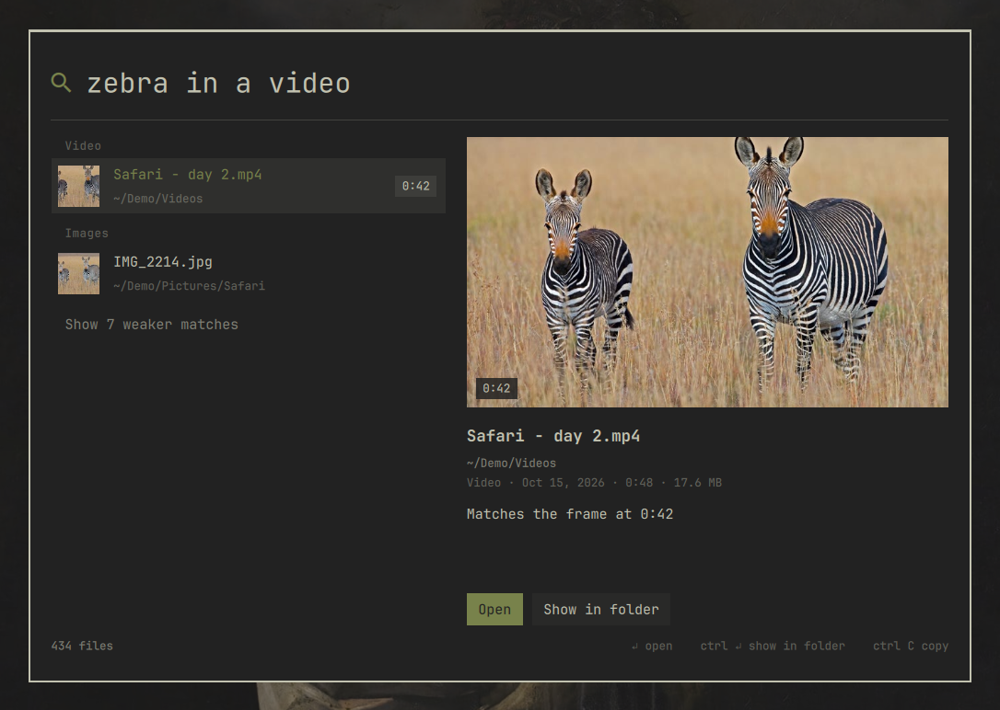
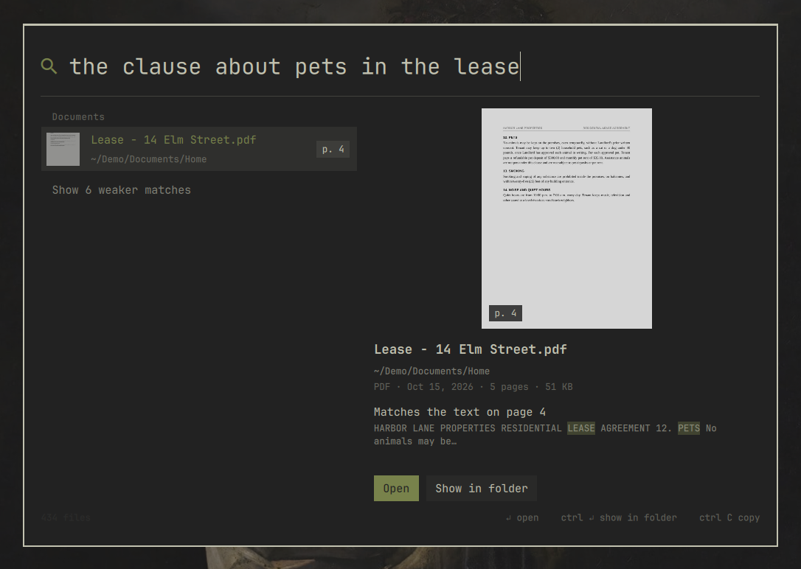
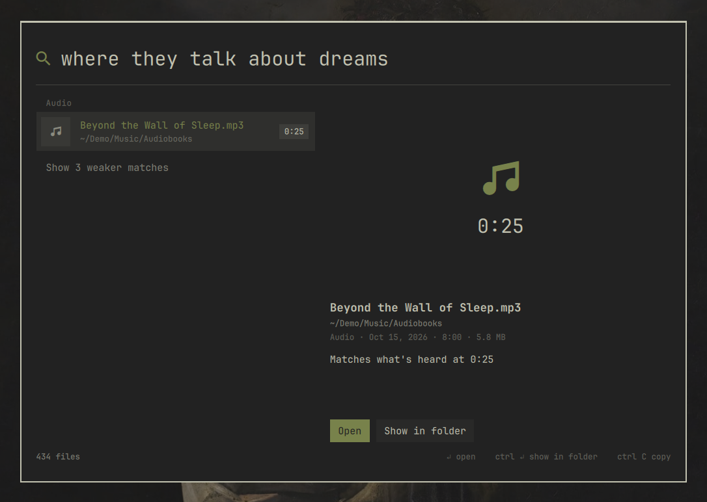
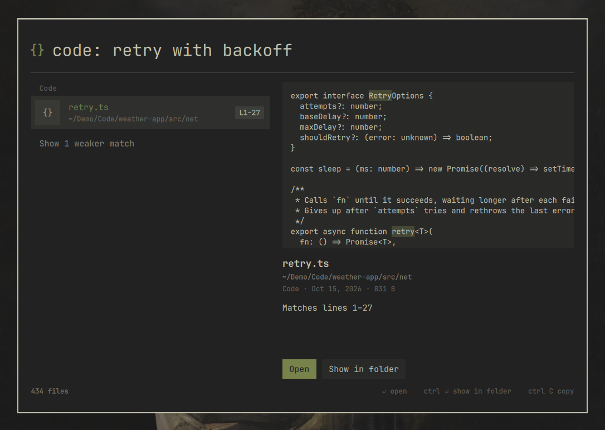
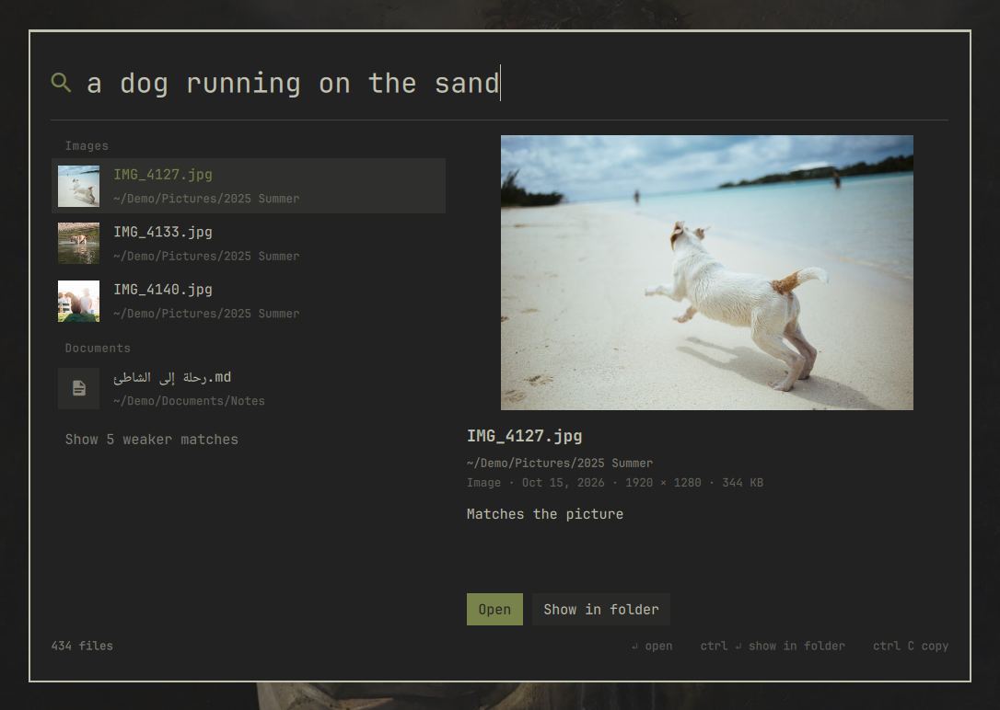

<h1 align="center">DigUp for Omarchy</h1>

<p align="center">
  Search your files by what's in them, right from the Omarchy shell.<br>
  Describe a photo, a page, a moment in a recording or what some code does. DigUp finds it and opens it there.
</p>

<p align="center">
  
</p>

Spotlight-style search finds files by their names. DigUp reads what's inside them: the pictures in your photos,
the pages of your PDFs, what's said in your recordings and the frames of your videos. Everything runs on your
computer, and nothing you index leaves it.

This plugin is the Omarchy front end for [DigUp](https://github.com/ARahim3/DigUp) by Abdur Rahim, which does the
reading and searching with Google DeepMind's EmbeddingGemma 2.

## What you can find

| | |
|---|---|
|  |  |
| **A page in a PDF.** "the clause about pets in the lease" opens the lease at page 4. | **A moment in a recording.** "where they talk about dreams" plays the audiobook from 0:25. |
|  |  |
| **Code by what it does.** Start with `code:` to search your projects. | **Any language.** An English search also finds a note written in Arabic. |

## Install

You need Omarchy 4 on a 64-bit Intel or AMD computer, and about 1 GB of free space.

**1. Add the plugin.**

```sh
omarchy plugin add https://github.com/Nuu-maan/omarchy-digup.git --enable
```

**2. Install DigUp's search engine.**

```sh
~/.config/omarchy/plugins/io.github.nuu-maan.digup/bin/install-helper
```

This downloads DigUp's Linux engine (about 140 MB) and checks it against a pinned checksum. The first time the
plugin starts, it downloads the model (865 MB, once) and starts reading `~/Documents` and `~/Pictures`.

**3. Add a shortcut.** Add this line to `~/.config/hypr/bindings.lua`:

```lua
o.bind("SUPER + D", "DigUp", "omarchy-shell shell toggle io.github.nuu-maan.digup '{}'")
```

Optionally, to make the panel open instantly like Omarchy's own menus, add this to `~/.config/hypr/looknfeel.lua`:

```lua
hl.layer_rule({ match = { namespace = "^omarchy-digup$" }, no_anim = true, animation = "none" })
```

Press <kbd>Super</kbd> <kbd>D</kbd> and describe what you're looking for.

## Use

| Key | Action |
|---|---|
| <kbd>Super</kbd> <kbd>D</kbd> | Open the panel |
| <kbd>↑</kbd> <kbd>↓</kbd> | Move through the results |
| <kbd>Enter</kbd> | Open the result at its page, moment or line |
| <kbd>Ctrl</kbd> <kbd>Enter</kbd> | Show it in your file manager |
| <kbd>Ctrl</kbd> <kbd>C</kbd> | Copy the file |
| <kbd>Esc</kbd> | Clear the search, then close |

Results open where they matched: PDFs at the page in Evince, Papers, Zathura or Okular, recordings and videos at the
moment in mpv, and code at the line in your Omarchy editor. Everything else opens in its default app.

To open the panel with a search already typed, for example from another key:

```sh
omarchy-shell shell summon io.github.nuu-maan.digup '{"query":"code: "}'
```

## Choose what it reads

The plugin reads the folders listed in `~/.config/omarchy/digup.json`:

```json
{
  "folders": ["~/Documents", "~/Pictures"],
  "code": []
}
```

Add folders to `folders`. Add your projects to `code` to turn on `code:` search. Changes apply as soon as you save.

The first pass takes a few seconds per picture on a processor alone, so a large photo library can take a while. The
panel's footer shows how far it has got. On battery, it pauses the first pass and picks up again when you plug in.
After that, new files are found within ten minutes.

DigUp never reads keys, password files, hidden folders like `.ssh`, apps or caches, and it never changes, moves or
uploads your files.

## How it works

- `Service.qml` starts with the Omarchy shell and runs three of DigUp's commands: `search-service` keeps the index
  open and the model warm, `index-service` reads new and changed files, and `download-model` runs on first start.
- `Search.qml` is the panel. It matches your words on every keystroke and the meaning once you pause, then shows
  whichever result is newest.
- `bin/digup-open` opens results in your apps.

Tests for the result logic run with `node tests/model.test.js`.

## Uninstall

```sh
omarchy plugin remove io.github.nuu-maan.digup
rm -rf ~/.local/share/digup ~/.config/omarchy/digup.json
```

Then remove the lines you added to `bindings.lua` and `looknfeel.lua`.

## Credits

- [DigUp](https://github.com/ARahim3/DigUp) by Abdur Rahim (MIT), and Google DeepMind's
  [EmbeddingGemma 2](https://huggingface.co/google/embeddinggemma-2) (Apache 2.0).
- Screenshot photos are CC0, from Unsplash via Wikimedia Commons. The audiobook is LibriVox's public domain reading
  of *Beyond the Wall of Sleep* by H. P. Lovecraft.

## License

MIT
